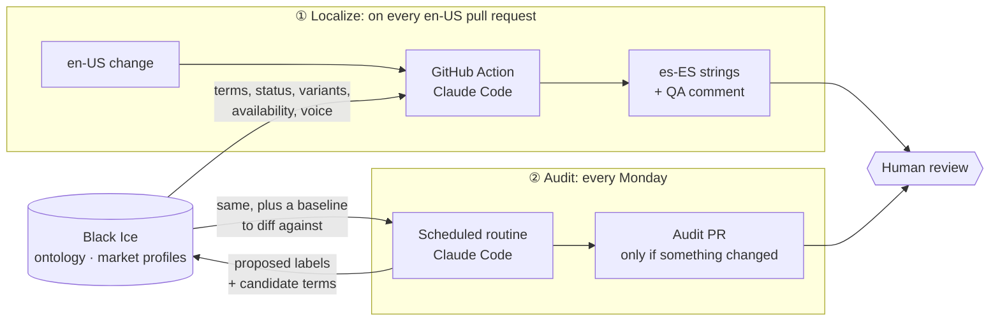

# echocraft-locales

**An experiment in zero-touch localization: AI agents translate and audit UI strings, and [Black Ice](https://black-ice.ai) governs the terminology and style they use, over MCP.**

Echocraft is a fictional music-production app. This repo holds its UI strings, with `en-US` as the source and `es-ES` as the first target. Nobody translates them by hand. Two Claude Code pipelines do the work:

- **Localize**: when English strings change, an agent writes the Spanish.
- **Audit**: every week, an agent re-checks all Spanish strings against the current state of the ontology.

Black Ice is the single source of truth for both. Humans review pull requests and decide on terminology. They don't write strings.

---

## Why

The usual way localization drifts:

1. A string is translated once, at PR time, against whatever the term base said **that day**.
2. The terminology keeps moving. A pending term gets approved, a feature is renamed, or a feature is pulled from a market.
3. The strings that already shipped don't notice.

This repo tests whether AI agents can close both gaps. They write each new string against the ontology as it is right now, and they keep checking old strings as the ontology changes. A terminologist curates Black Ice, and everything else follows from it.

## How it works



### ① Localize: `.github/workflows/localize-es.yml`

It runs on every pull request that touches `locales/en-US/**`.

1. It diffs en-US against the base branch and picks out new or changed keys only.
2. It loads the **es-ES market profile** from Black Ice: voice, register, locale conventions and golden examples.
3. For every domain term, it calls `check_term` to get the approved Spanish term, its status and its forbidden variants.
4. It **transcreates** each string instead of translating it word for word. It writes for the UI surface the string appears on, keeps placeholders intact (moving them when Spanish grammar needs it), and keeps to the length budget.
5. It runs each draft through `validate_translation` and fixes anything that gets flagged.
6. It commits the es-ES strings to the same PR and posts a **QA report** as a comment. The report covers terms used, new term candidates, placeholder concerns and source-string issues. It's a warning only and never blocks the merge.

Prompt: [`.github/prompts/localize-es-ES.md`](.github/prompts/localize-es-ES.md)

### ② Audit: a scheduled Claude Code routine

A cloud agent runs **every Monday at 08:00 UTC**. It re-checks the **whole** es-ES corpus against Black Ice, not just recent changes.

| Check | What it catches |
|---|---|
| **Term match** | An es-ES string doesn't use the Black Ice term |
| **Forbidden variants** | A string uses a variant Black Ice forbids |
| **Status change** | A term, status or availability changed since last week (compared against [`audit-baseline.json`](.github/qa/audit-baseline.json)) |
| **Market availability** | A feature that's `planned` or `not_available` in Spain is still sold in plan or upsell copy |
| **English label change** | A concept was renamed in Black Ice, but en-US strings still use the old label |

It also **feeds terms back into Black Ice**, for a human to review:

| Situation | Tool | Lands in Black Ice as |
|---|---|---|
| The concept exists but has no es-es term | `propose_translation` | A `pending` es-es label on that concept |
| No concept matches at all | `suggest_candidates` | An entry in the Candidates review queue |

It **only opens a PR if something actually changed**: a status change, a new finding, a proposed label or a new candidate. If nothing changed, it opens no PR and only leaves a two-line summary in the run history.

Every finding names each affected string by its exact ID (`namespace:full.key.path`), with the quoted en-US and es-ES text. The report ends with a fix list in three groups:

1. **Needs a string fix**
2. **Needs a product or terminology decision**
3. **Changed in Black Ice, strings already in sync**

Prompt: [`.github/prompts/audit-es-ES.md`](.github/prompts/audit-es-ES.md) · Latest merged report: [`.github/qa/audit-report.md`](.github/qa/audit-report.md) · All audit PRs: [search](https://github.com/Julia-IO/echocraft-locales/pulls?q=is%3Apr+%22es-ES+terminology+audit%22)

## What Black Ice provides

Black Ice exposes the ontology as an MCP server (`https://mcp.black-ice.ai/mcp`). The agents use these tools:

| Tool | Used by | Purpose |
|---|---|---|
| `get_market_profile` | both | Brand voice, register, locale conventions, golden examples |
| `list_concepts` | both | Every concept with its term, status and availability per locale |
| `check_term` | both | Approved term, allowed and forbidden variants, notes |
| `validate_translation` | both | Scans a draft for forbidden or non-preferred variants |
| `propose_translation` | audit | Proposes a missing target label (always lands as `pending`) |
| `suggest_candidates` | audit | Sends ungoverned terms to the Candidates queue |

Neither pipeline can call the tools that change the ontology itself (`set_concept_definition`, `set_market_availability`, `add_relationship`, `create_relationship_type`). Those changes are left to people.

## Repository layout

```
locales/
  en-US/                 source strings (written by people)
  es-ES/                 target strings (written by the Localize pipeline)
.github/
  workflows/
    localize-es.yml      ① Localize: GitHub Action
  prompts/
    localize-es-ES.md    ① instructions for the localization agent
    audit-es-ES.md       ② instructions for the audit agent
  qa/
    qa-report.md         ① latest localization QA report
    audit-report.md      ② latest merged audit report
    audit-baseline.json  ② ontology snapshot the audit compares against
  mcp/
    black-ice.json       MCP server config for the Action (key injected at runtime)
```

Each namespace (`dashboard`, `onboarding`, `errors`, `validation`, `sample`) is a JSON file with the same keys in every locale. `_metadata` and `_notes` blocks give context to people and agents, and are never translated.

## Guardrails

- **Agents always work through pull requests.** Neither pipeline pushes to `main` or merges anything.
- **Each pipeline has a limited scope.**
  - Localize writes only to `locales/es-ES/` and its QA report. It never touches en-US.
  - Audit writes only to its report and baseline. It never edits strings.
- **Write access to Black Ice is limited.** Localize uses read-only tools only. Audit can only propose labels and candidates, and it is blocked from every other write tool.
- **Black Ice suggestions are never final.** Proposed labels land as `pending`, and candidates wait for a terminologist to review them.
- **The prompts live in the repo**, so every change to the agents' behavior is a reviewable PR.

## Setup

**Localize (GitHub Action):** add two repository secrets:

- `ANTHROPIC_API_KEY`
- `BLACK_ICE_API_KEY`: the workflow writes it into `.github/mcp/black-ice.json` at runtime.

**Audit (routine):** a [Claude Code routine](https://claude.ai/code/routines) set up as follows:

- It points at this repo and has the Black Ice connector from claude.ai attached.
- Its task is to follow `.github/prompts/audit-es-ES.md`.
- Black Ice's ontology-editing tools are listed in the routine's `disallowed_tools`.

## Lessons so far

- **Black Ice locale arguments must be lowercase** (`es-es`). `es-ES` returns every field as `null` without an error, so the ontology looks empty. Both prompts force lowercase.
- **A missing label is not a new concept.** If the English concept exists, the Spanish wording goes in as a *target label* (`propose_translation`). Only terms with no concept go to the Candidates queue.
- **Design for "nothing happened."** A weekly job that always opens a PR trains people to ignore it.
- **Test drift on purpose.** We broke a term in Black Ice, renamed a concept and then reverted the change. Each time, the audit had to notice.
- **Spell out "every".** Agents vary from run to run. Anything that must happen every time (check every concept, validate every string, name every affected string ID) has to be stated explicitly in the prompt.
- **Test guardrails before trusting them.** One tool-permission setting saved without errors but blocked nothing. We only found out by running a test routine that lists the tools it can see.

## Roadmap

- [ ] More markets: `fr-FR` and `it-IT` (already defined in Black Ice)
- [ ] An optional **fix step**: a second PR that rewrites strings for findings against *approved* terms only
- [ ] Allowed and forbidden variants defined in Black Ice, so `validate_translation` has something to catch

---

*Built with [Claude Code](https://claude.com/claude-code) and [Black Ice](https://black-ice.ai). Echocraft is fictional; the pipelines are real.*
